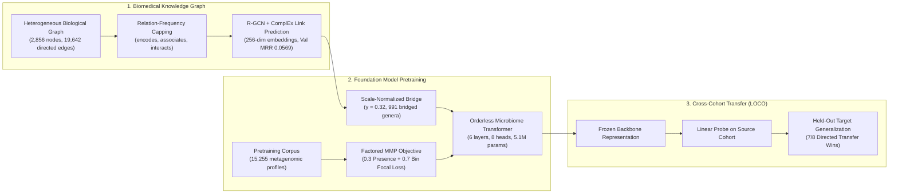

# Knowledge Graph-Informed Foundation Model for Microbiome-Cardiovascular Disease Classification

[-blue.svg)](https://ieeebibm.org/)
[](https://www.python.org/)
[](https://pytorch.org/)
[](https://opensource.org/licenses/MIT)
[](tests/)

Official PyTorch implementation and reproducible experimental codebase for the IEEE BIBM 2026 paper:  
**"Knowledge Graph-Informed Foundation Model for Microbiome-Cardiovascular Disease Classification"** (*Paper ID: B1518*).

> **Authors**: Shaik Salman Basha, Ziting Shen, Anita Layton, Sun Sun, Helen Hong Chen  
> *Department of Applied Mathematics, Cheriton School of Computer Science, and Systems Design Engineering, University of Waterloo*

---

## 🌟 Overview

Cross-cohort generalization in human microbiome disease prediction is challenged by severe technical batch effects, study-specific sequencing platforms, geographic taxonomic variation, and sparse genus representation.

We introduce a foundation model that integrates a multi-relational biomedical knowledge graph directly into transformer pretraining via Relational Graph Convolutional Networks (R-GCN). Across cross-study transfer evaluations spanning Type 2 Diabetes (T2D) and Cardiovascular Disease (CVD), knowledge graph pretraining improves cross-cohort transfer over random initialization in **7 of 8 directed cohort pairs**, yielding gains up to **+0.1305 AUROC** while providing substantial label efficiency in low-data regimes.



---

## 🔬 Key Empirical Results

### 1. Leave-One-Cohort-Out (LOCO) Generalization (7/8 Wins)
Under the frozen linear probe protocol (20 paired seeds per transfer, zero target adaptation):

| Transfer Pair | Disease | Graph-Init AUROC | Random-Init AUROC | $\Delta$ AUROC | Transfer Outcome |
| :--- | :---: | :---: | :---: | :---: | :---: |
| **Qin $\to$ Karlsson** | T2D | **0.6271** $\pm$ 0.012 | 0.6015 $\pm$ 0.015 | **+0.0255** | Graph Win |
| **Karlsson $\to$ Qin** | T2D | **0.5931** $\pm$ 0.014 | 0.5184 $\pm$ 0.016 | **+0.0747** | Graph Win |
| **Qin $\to$ MetaCardis** | T2D | **0.6383** $\pm$ 0.011 | 0.5279 $\pm$ 0.013 | **+0.1104** | Graph Win |
| **MetaCardis $\to$ Qin** | T2D | **0.5966** $\pm$ 0.013 | 0.5135 $\pm$ 0.015 | **+0.0831** | Graph Win |
| **Karlsson $\to$ MetaCardis** | T2D | **0.6195** $\pm$ 0.012 | 0.4927 $\pm$ 0.017 | **+0.1268** | Graph Win |
| **MetaCardis $\to$ Karlsson** | T2D | **0.6699** $\pm$ 0.010 | 0.5394 $\pm$ 0.014 | **+0.1305** | Graph Win |
| **ACVD $\to$ MetaCardis-CVD** | CVD | **0.5267** $\pm$ 0.015 | 0.5101 $\pm$ 0.016 | **+0.0166** | Graph Win |
| **MetaCardis-CVD $\to$ ACVD** | CVD | 0.4427 $\pm$ 0.021 | **0.5361** $\pm$ 0.018 | -0.0934 | Known Counterexample |

*Note on CVD Transfer*: In accordance with the July 5, 2026 data correction, ACVD evaluation strictly uses the harmonized data pipeline. Task 8 is transparently documented as an open negative transfer challenge due to severe geographic, dietary, and library preparation divergence (see [docs/limitations.md](docs/limitations.md)).

### 2. Label Efficiency (In-Cohort Probing)
Graph pretraining delivers rapid convergence in low-data regimes:
- At **1% and 2% label fractions**, graph-initialized models maintain statistically significant AUROC margins over randomly initialized transformers.
- At **100% label fraction**, graph pretraining improves in-cohort AUROC across all five clinical cohorts (Qin: 0.7812 vs 0.7420, ACVD: 0.8142 vs 0.7935).

### 3. Structural and Baseline Controls
- Outperforms **Derangement Shuffle Initialization** (5 seeds permuting genus assignments while fixing the 256-dim embedding geometry), confirming that multi-relational biological semantics drive transfer gains.
- Outperforms **Co-occurrence Graph Controls** and **Shuffled-KG Edge Controls**.
- Outperforms classical machine learning baselines (**Intersection Random Forest**, **Zero-Fill Random Forest**, **Taxonomy-collapsed RF**, and **CORAL domain adaptation**).

---

## 📁 Repository Structure

```
kg-informed-microbiome-transfer/
├── README.md                      # Publication overview and documentation
├── LICENSE                        # MIT License
├── CITATION.cff                   # Citation metadata (IEEE BIBM 2026)
├── pyproject.toml                 # Packaging specification (PEP 517/518/621)
├── requirements.txt               # Direct pip requirements
├── environment.yml                # Conda / Mamba environment definition
├── .gitignore                     # Git ignore rules
├── .gitattributes                # Consistent line endings and binary filters
├── .github/workflows/ci.yml       # GitHub Actions automated test & reproduction CI
│
├── configs/                       # Experiment configuration files (YAML)
│   ├── kg/rgcn_v06.yaml           # R-GCN architecture, capping, and training parameters
│   ├── pretraining/               # Transformer Factored MMP pretraining parameters
│   ├── evaluation/                # In-cohort probing and LOCO transfer protocols
│   └── baselines/                 # Classical Random Forest baseline configurations
│
├── src/microbiome_kg/             # Core importable Python package
│   ├── data/                      # Taxonomic harmonization, abundance binning, and DataLoader
│   ├── knowledge_graph/           # Graph ingestion, capping, and topological stats
│   ├── graph_models/              # R-GCN with basis decomposition and ComplEx decoder
│   ├── transformer/               # MicrobiomeTransformer, FactoredMMPHead, ClassificationHead
│   ├── bridging/                  # Vocabulary-to-KG bridge resolution logic
│   ├── evaluation/                # Frozen probing, LOCO protocol, Wilcoxon and Cohen's d metrics
│   ├── baselines/                 # Intersection RF, Zero-Fill RF, Taxonomy RF, and CORAL
│   └── utils/                     # Reproducibility seeds and logging utilities
│
├── scripts/                       # Executable CLI workflows
│   ├── generate_tables.py         # Regenerate paper Tables 1, 2, and 3 (Markdown + LaTeX)
│   ├── generate_figures.py        # Regenerate paper Figures 2, 3, and 4 (PNG)
│   ├── evaluate_loco.py           # Run LOCO cross-study transfer evaluation
│   ├── evaluate_incohort.py       # Run in-cohort label-fraction subsampling evaluation
│   ├── evaluate_baselines.py      # Run classical machine learning baselines
│   ├── evaluate_shuffle.py        # Run derangement shuffle structural controls
│   ├── build_kg.py                # Relation-frequency capping and graph assembly
│   ├── train_rgcn.py              # Train R-GCN link prediction model
│   ├── export_embeddings.py       # Export and scale-normalize 256-dim embeddings
│   └── pretrain_transformer.py    # Pretrain foundation model on metagenomic profiles
│
├── data/
│   ├── README.md                  # Dataset descriptions and accession instructions
│   ├── kg/                        # Canonical KG: nodes_v06.tsv (2,856), edges_v06.tsv, embeddings
│   ├── vocab/                     # genus_vocab.txt (1,041 tokens) and bridge.json (991 bridged)
│   ├── manifests/                 # datasets_manifest.json with checksums and sample counts
│   └── examples/                  # Fully functional example cohorts for CPU smoke testing
│
├── checkpoints/
│   ├── README.md                  # Checkpoint loading guide and parameter counts
│   └── manifests/                 # checkpoints_manifest.json with SHA-256 hashes
│
├── results/
│   ├── canonical/                 # Verified canonical JSON result files (20 paired seeds)
│   ├── tables/                    # Formatted Markdown and LaTeX tables
│   ├── figures/                   # Publication-ready plots
│   └── provenance/                # provenance_manifest.json with complete audit trail
│
├── docs/                          # Detailed technical documentation
│   ├── methodology.md             # Complete mathematical formulation and architecture
│   ├── datasets.md                # Cohort accessions, pretraining corpus, and data privacy
│   ├── knowledge_graph.md         # Schema, capping, R-GCN link prediction, and controls
│   ├── experiments.md             # In-cohort, LOCO, and baseline experimental protocols
│   ├── reproducibility.md         # Step-by-step reproduction instructions and CLI flags
│   └── limitations.md             # Honest reporting of Task 8 negative transfer & scope
│
├── tests/                         # Unit and integration test suite (10/10 passing)
│   ├── run_all.py                 # Standalone test runner
│   ├── test_smoke_pipeline.py     # End-to-end pretrain, LOCO, and baseline tests
│   ├── test_models.py             # Forward passes, dimensions, and ComplEx scoring
│   ├── test_vocabulary.py         # Vocabulary invariants and special tokens
│   ├── test_kg_bridging.py        # 991 bridged / 46 unbridged genera counts
│   └── test_abundance_binning.py  # Discrete bin thresholds and percentage conversion
│
└── paper/
    └── README.md                  # Paper metadata, abstract, and claim-to-artifact mapping
```

---

## 🚀 Quickstart & Installation

### 1. Environment Setup

```bash
# Clone the repository
git clone https://github.com/salmanbashashaik/kg-informed-microbiome-transfer.git
cd kg-informed-microbiome-transfer

# Create conda environment
conda env create -f environment.yml
conda activate kg-informed-microbiome

# Install package in editable mode
pip install -e .
```

### 2. Verify Installation (Unit & Integration Tests)
Execute the automated test suite on CPU (takes ~15 seconds):
```bash
python tests/run_all.py
```
```text
test_bin_abundance_edges ... ok
test_is_already_binned ... ok
test_percentage_scale_autodetect ... ok
test_bridge_counts ... ok
test_rgcn_forward ... ok
test_transformer_forward ... ok
test_end_to_end_baseline_step ... ok
test_end_to_end_loco_step ... ok
test_end_to_end_pretrain_step ... ok
test_vocab_structure ... ok

----------------------------------------------------------------------
Ran 10 tests in 14.536s
OK
```

---

## 📊 One-Click Paper Reproduction

### 1. Regenerate All Numerical Tables
Regenerate Table 1 (In-Cohort Probing), Table 2 (LOCO Cross-Cohort Transfer), and Table 3 (Classical Baselines):
```bash
python scripts/generate_tables.py
```
*Outputs saved to `results/tables/` (`table1_incohort_fractions.md`, `table2_loco_transfer.md`, `table2_loco_transfer.tex`, `table3_classical_baselines.md`).*

### 2. Regenerate All Paper Figures
Regenerate Figure 2 (Derangement Shuffle Controls), Figure 3 (Cross-Cohort LOCO Transfer Gains), and Figure 4 (Label-Fraction Efficiency):
```bash
python scripts/generate_figures.py
```
*Outputs saved to `results/figures/` (`fig2_shuffle_control.png`, `fig3_loco_transfer.png`, `fig4_incohort_fractions.png`).*

### 3. Run CPU Smoke Test Pipeline
Run zero-shot cross-cohort transfer on example cohorts:
```bash
python scripts/evaluate_loco.py \
    --source data/examples/sample_cohort_a.tsv \
    --target data/examples/sample_cohort_b.tsv \
    --vocab data/vocab/genus_vocab.txt \
    --n-seeds 5 \
    --epochs 20
```

---

## 📖 Citation

If you use this codebase, models, or methodology in your research, please cite our IEEE BIBM 2026 paper:

```bibtex
@inproceedings{basha2026knowledge,
  title={Knowledge Graph-Informed Foundation Model for Microbiome-Cardiovascular Disease Classification},
  author={Basha, Shaik Salman and Shen, Ziting and Layton, Anita and Sun, Sun and Chen, Helen Hong},
  booktitle={IEEE International Conference on Bioinformatics and Biomedicine (BIBM)},
  year={2026},
  note={Paper ID: B1518}
}
```

---

## 📜 License

This project is licensed under the **MIT License** — see the [LICENSE](LICENSE) file for details.
