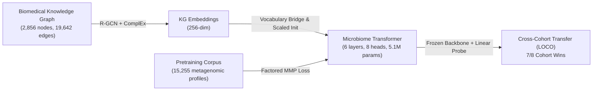

# Methodology

This document details the mathematical formulation, architecture, and training protocols of the Knowledge Graph-Informed Foundation Model presented in our IEEE BIBM 2026 paper (*Paper ID: B1518*).

---

## 1. Overview and Problem Formulation

Microbiome-based disease classification models typically suffer from poor cross-cohort generalizability due to technical batch effects, study-specific sequencing protocols, geographic variation in taxonomic distributions, and sparse genus representation.

We propose bridging multi-relational biomedical knowledge with foundation model pretraining. Our approach consists of three coordinated stages:
1. **Biological Knowledge Graph (KG) Construction**: Assembling a heterogeneous biomedical graph linking microbial taxa, metabolites, enzymatic pathways, human cardiovascular phenotypes, and diet/lifestyle factors.
2. **Relational Graph Representation Learning (R-GCN)**: Learning dense 256-dimensional entity representations that encode multi-hop relational dependencies.
3. **Knowledge-Informed Transformer Pretraining**: Projecting R-GCN embeddings into a transformer backbone trained via Factored Masked Microbiome Prediction (MMP) over 15,255 unlabelled metagenomic profiles.

---

## 2. Multi-Relational Knowledge Graph Learning

### 2.1 Graph Formulation
Let $\mathcal{G} = (\mathcal{V}, \mathcal{E}, \mathcal{R})$ denote a directed multi-relational graph, where:
- $\mathcal{V}$ is the set of $N = 2,856$ biological entities across 15 entity types (including `Microbe`, `Metabolite`, `Pathway`, `Disease`, `Food`, `Gene`).
- $\mathcal{R}$ is the set of $|\mathcal{R}| = 23$ biological relation types (e.g., `produces`, `consumes`, `inhibits`, `associates_with`).
- $\mathcal{E} \subseteq \mathcal{V} \times \mathcal{R} \times \mathcal{V}$ is the set of directed edges $(s, r, o)$.

To avoid dominance by ultra-dense generic relations (e.g., universal metabolic co-factors), relations with counts exceeding 5,000 edges are capped using reproducible random sampling (`seed=42`), yielding the canonical training graph of 19,642 directed edges.

### 2.2 Relational Graph Convolutional Network (R-GCN)
At layer $l$, entity node representations $\mathbf{h}_i^{(l)} \in \mathbb{R}^{d}$ are updated via relation-specific message passing with basis decomposition:

$$\mathbf{h}_i^{(l+1)} = \sigma \left( \mathbf{W}_0^{(l)} \mathbf{h}_i^{(l)} + \sum_{r \in \mathcal{R}} \sum_{j \in \mathcal{N}_i^r} \frac{1}{c_{i,r}} \mathbf{W}_r^{(l)} \mathbf{h}_j^{(l)} \right)$$

where $\mathcal{N}_i^r$ denotes the set of neighbors of entity $i$ under relation $r$, $c_{i,r} = |\mathcal{N}_i^r|$ is a normalization constant, and relation transformation matrices $\mathbf{W}_r^{(l)}$ are decomposed into $B = 30$ basis matrices:

$$\mathbf{W}_r^{(l)} = \sum_{b=1}^{B} a_{rb}^{(l)} \mathbf{V}_b^{(l)}$$

### 2.3 ComplEx Decoder and Link Prediction
Link prediction scores for candidate triples $(s, r, o)$ are evaluated in complex space using the ComplEx scoring function:

$$f(s, r, o) = \text{Re} \left( \langle \mathbf{e}_s, \mathbf{w}_r, \bar{\mathbf{e}}_o \rangle \right) = \sum_{k=1}^{d/2} \left[ \text{Re}(e_{s,k}) \text{Re}(w_{r,k}) \text{Re}(e_{o,k}) + \text{Re}(e_{s,k}) \text{Im}(w_{r,k}) \text{Im}(e_{o,k}) + \text{Im}(e_{s,k}) \text{Re}(w_{r,k}) \text{Im}(e_{o,k}) - \text{Im}(e_{s,k}) \text{Im}(w_{r,k}) \text{Re}(e_{o,k}) \right]$$

Training optimizes self-adversarial negative sampling loss with contrastive regularizations to combat embedding anisotropy.

---

## 3. Microbiome Transformer Architecture

### 3.1 Input Formulation and Factored Embeddings
A microbiome sample is represented as a sequence of detected microbial genera paired with their discrete abundance levels.
- **Vocabulary $\mathcal{V}_{\text{micro}}$**: 1,041 total tokens (4 special tokens: `[PAD]`, `[MASK]`, `[CLS]`, `[UNK]`, and 1,037 genus tokens).
- **Abundance Discretization**: Relative abundance values $x \in [0, 1]$ are binned into 5 ordinal levels:
  - Bin 0: Absent ($x = 0$)
  - Bin 1: Trace ($0 < x \le 10^{-4}$)
  - Bin 2: Low ($10^{-4} < x \le 10^{-3}$)
  - Bin 3: Medium ($10^{-3} < x \le 10^{-2}$)
  - Bin 4: High ($x > 10^{-2}$)

For each position $t$, the input representation $\mathbf{z}_t^{(0)} \in \mathbb{R}^{d_{\text{model}}}$ is the sum of genus identity embedding and abundance bin embedding:

$$\mathbf{z}_t^{(0)} = \mathbf{E}_{\text{genus}}[g_t] + \mathbf{E}_{\text{bin}}[b_t]$$

A special `[CLS]` token is prepended to the sequence to accumulate global microbiome profile representations.

### 3.2 Knowledge Graph Bridging & Scale Normalization
Of the 1,037 genus tokens, 991 bridge directly to canonical entities in $\mathcal{G}$. Let $\mathbf{e}_g^{\text{RGCN}} \in \mathbb{R}^{d_{\text{model}}}$ be the R-GCN embedding of genus $g$.
To prevent gradient instability and ensure matched variance with standard initialization schemes ($\mathcal{N}(0, 0.02^2)$), R-GCN embeddings are scaled prior to injection:

$$\mathbf{E}_{\text{genus}}[g] = \gamma \cdot \frac{\mathbf{e}_g^{\text{RGCN}}}{\|\mathbf{e}_g^{\text{RGCN}}\|_2}$$

where $\gamma = 0.02 \times \sqrt{d_{\text{model}}} = 0.02 \times \sqrt{256} = 0.32$. Unbridged genera (46 tokens) are initialized from $\mathcal{N}(0, 0.02^2)$.

### 3.3 Transformer Backbone Configuration
- Layers: $L = 6$
- Hidden dimension: $d_{\text{model}} = 256$
- Feedforward dimension: $d_{\text{ff}} = 1024$
- Attention heads: $H = 8$ ($d_k = 32$ per head)
- Dropout: 0.1
- Pre-layer normalization (`norm_first=True`)
- Total parameters: 5,148,829 (~5.1M)

---

## 4. Factored Masked Microbiome Prediction (MMP)

During pretraining on 15,255 unlabelled samples, 30% of non-zero genera and 5% of zero genera are randomly masked with `[MASK]`. The model must jointly predict:
1. **Presence/Absence**: Binary cross-entropy determining whether the masked position is biologically present.
2. **Abundance Bin**: Focal loss over the 4 non-zero abundance bins ($\gamma = 2.0$) to handle class imbalances across abundance tiers.

The composite pretraining objective is:

$$\mathcal{L}_{\text{MMP}} = 0.3 \cdot \mathcal{L}_{\text{presence}} + 0.7 \cdot \mathcal{L}_{\text{bin\_focal}}$$

---

## 5. Downstream Evaluation Protocols

### 5.1 Frozen Linear Probing (In-Cohort)
To rigorously isolate the quality of the learned representations without confounds from backbone fine-tuning:
1. The transformer backbone, embedding table, and abundance embeddings are strictly frozen.
2. A single linear classification head $\mathbf{W}_{\text{clf}} \in \mathbb{R}^{2 \times 256}$ is trained on the extracted `[CLS]` token embedding.
3. Evaluated across 6 subsampled label fractions: 1%, 2%, 5%, 25%, 50%, and 100%, using 20 paired random seeds.

### 5.2 Leave-One-Cohort-Out (LOCO) Cross-Study Transfer
To evaluate true zero-shot out-of-distribution generalizability:
1. Linear probe is trained strictly on the source cohort (e.g., Qin T2D).
2. Deployed directly on an unobserved target cohort (e.g., Karlsson T2D or MetaCardis T2D) without any target labels or domain adaptation.
3. Evaluated across 8 directed cross-study transfers spanning Type 2 Diabetes and Cardiovascular Disease.
